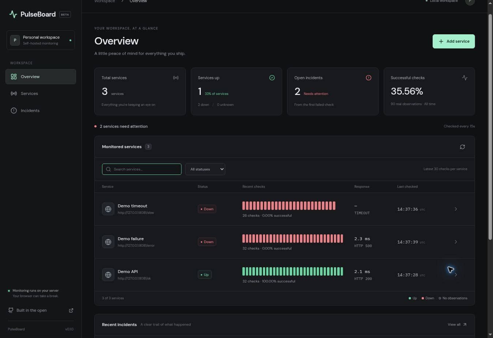
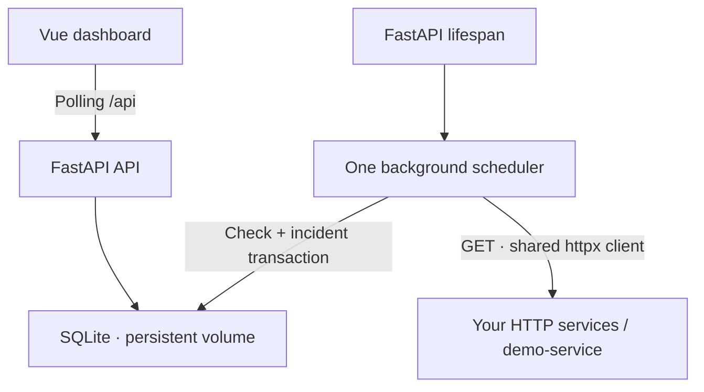

# PulseBoard

**Small projects. Clear signals.**

PulseBoard is an open source, self-hosted HTTP monitor for small projects. Add a service URL, close your
browser, and let your server keep watching. A compact Vue dashboard shows real checks, response times,
observation gaps, and incidents linked to the check that opened them.



[Service detail screenshot](docs/screenshots/service-20261107.jpg) ·
[Narrow viewport screenshot](docs/screenshots/mobile-20261107.jpg)

## Start locally

Requirements: Docker Engine with the Docker Compose v2 plugin. On an Ubuntu VMware client, run these
commands **inside the VM**, then open the dashboard in that VM's browser.

```bash
cd pulseboard
cp .env.example .env
docker compose up -d --build --wait
docker compose ps
```

Open **http://127.0.0.1:8080**. API docs: **http://127.0.0.1:8000/api/docs**.
All local published ports bind to `127.0.0.1`.

If your user cannot access the Docker socket, run Docker commands with `sudo`. Run the container drill
as `sudo bash scripts/smoke_compose.sh` in that case.

Click **Add service** and use `Demo API` / `http://demo-service:8081/ok`.
`demo-service` is resolved by the backend on the Compose network; it does not need to resolve in the browser.
The first state is `UNKNOWN`, followed by `UP` after a successful check.

Other endpoints: `http://demo-service:8081/error` returns HTTP 500; `/slow` waits 65 seconds,
longer than the allowed check deadline. The UI uses `/api`, proxied to FastAPI by Nginx.

```bash
docker compose logs -f backend
docker compose stop demo-service    # Trigger a real failure
docker compose start demo-service   # Recover
docker compose down                # Keeps the SQLite volume
```

`docker compose down -v` **deletes monitoring data**. It is used only for disposable CI stacks.
For a separate Ubuntu server VM, use an SSH tunnel to keep the dashboard private:
`ssh -L 8080:127.0.0.1:8080 user@your-server`, then open `http://127.0.0.1:8080` on the client.

## What the MVP includes

- Add and delete HTTP(S) services; credentials embedded in URLs are rejected.
- Server-side checks, independent of dashboard requests or open tabs.
- Current and historical states, status codes, latency, and error categories.
- Search, status filters, real heartbeat strips, latency charts, and bounded history pages.
- First-failure incidents, first-success recovery, and links to the original evidence.
- SQLite persistence, observation-gap markers across restarts, and stale-state indicators.
- Backend-enforced read-only demo mode, Vercel SPA configuration, and an HTTPS API deployment example.

## Architecture



| Directory | Responsibility |
| --- | --- |
| `backend/app/api.py`, `models.py` | Typed REST API and validation |
| `backend/app/settings.py` | Validated environment configuration |
| `backend/app/database.py` | SQLite schema, reads, transactions, and persistence |
| `backend/app/checker.py` | HTTP observation, monotonic latency, and error classification |
| `backend/app/incidents.py` | Transactional incident transitions |
| `backend/app/monitor.py` | Scheduler, concurrency, isolation, and shutdown |
| `frontend/src/` | Vue SFCs, typed API client, pages, and composables |
| `demo-service/` | Deterministic healthy, failed, and slow endpoints |
| `scripts/` | Native development launcher and reproducible smoke tests |
| `deploy/` | Separate public-demo Compose stack and Caddy HTTPS configuration |

Use **one backend process and one Uvicorn worker**. The in-process scheduler does not coordinate
multiple processes. SQLite uses WAL, foreign keys, a busy timeout, and serialized access on an
`aiosqlite` connection. The event loop does not perform blocking SQLite calls.

## Monitoring rules

| State | Meaning |
| --- | --- |
| `UNKNOWN` | No checks have completed |
| `UP` | HTTP status 200–299 |
| `DOWN` | Any other HTTP status, timeout, or DNS/TLS/connection/protocol error |

GET is the only MVP method. Redirects are **not followed**. Certificate verification stays enabled.
One `httpx.AsyncClient` is reused. Proxy environment variables are ignored so that local Docker URLs
are checked directly. At most five requests run concurrently; the same service is never checked in
parallel. One failed check cannot stop other checks.

The interval is a **minimum delay after the previous completed observation**. A one-second scheduler
tick, request duration, or a full concurrency queue may increase the effective sampling interval.
This is a small single-server monitor, not a precision scheduler.

**Response time** is measured with `time.perf_counter()` from immediately before issuing the GET until
HTTP response headers are available. It includes client connection-pool wait, DNS, connection/TLS
setup when needed, and the wait for headers. It excludes downloading the response body. Streaming
bodies are closed without buffering. This is not a ping or a full-page load measurement.
There is both an HTTPX network inactivity timeout and an outer `asyncio.timeout` deadline.
If no HTTP response arrives, both HTTP status and latency are `null`; the UI shows `—`, never zero.
HTTP 500 has a measured latency because response headers did arrive.

Errors are categorized as `HTTP_STATUS`, `TIMEOUT`, `CONNECTION`, `DNS`, `TLS`, `PROTOCOL`, `NETWORK`,
or `INTERNAL`. DNS/TLS causes are classified when exposed by the transport, otherwise they fall back
to the connection category. Error messages do not expose raw exception dumps.
All stored timestamps are UTC. The UI explicitly displays UTC.

### Incidents, observation gaps, and statistics

1. The first failed check opens an incident, even if no success preceded it.
2. Repeated failures update the same incident.
3. The first success closes it and stores the closing check.
4. A later separate failure opens another incident.

Inserting the check, updating counters, and changing the incident happen in **one transaction**.
A partial unique index enforces at most one open incident per service. Deleting a service also deletes
its checks and incidents. A check finishing after deletion is discarded.

No synthetic successes or failures are inserted during downtime. Every colored heartbeat corresponds
to a real check ID. Hatched markers denote **no observations**, and are not counted as checks.
Within one backend run, a gap is detected when completed checks are farther apart than
`interval + total timeout + max(2 seconds, 20% of interval)`. The interval after the preceding
observation is the expected sampling allowance; the remaining gap is excluded from observed spans.
Across different backend runs, the entire time between the last pre-restart and first post-restart
observations is conservatively marked unknown, including short restarts. This also covers unclean shutdowns.
The chart uses elapsed UTC time on the x-axis, breaks lines at missing latency or gaps, and hatches
trailing stale periods. An old `UP` state is labeled stale, rather than silently treated as fresh.

An incident's **observed span** ends at its last actual observation and excludes recorded observation
gaps. Its detected and recovered timestamps are not the exact physical beginning/end of an outage.
Sampling cannot establish availability between checks. An open incident stays open across restarts.

**Successful checks %** = actual successful observations / all actual observations for currently
configured services. This is an all-time, check-based ratio, **not time-weighted uptime or an SLA**.
No observations means `null`. Deleting a service removes its contributions. Dashboard counters use
stored observations. API connection errors are shown separately and never change a service's state.

## Configuration

Compose reads `.env`. For native development, the launcher runs FastAPI from the repository root,
where Pydantic Settings also reads `.env`. Environment values override the file.

| Variable | Default | Validation / purpose |
| --- | --- | --- |
| `PULSE_INTERVAL_SECONDS` | `15` | 1–3600, minimum delay after completion |
| `PULSE_TIMEOUT_SECONDS` | `5` | 0.01–60, total deadline |
| `PULSE_NETWORK_TIMEOUT_SECONDS` | `3` | 0.01–60 and no greater than total timeout |
| `PULSE_CONCURRENCY` | `5` | 1–5 |
| `PULSE_MAX_SERVICES` | `100` | 1–1000 |
| `PULSE_DATABASE_PATH` | `data/pulseboard.sqlite3` | Compose sets `/data/pulseboard.sqlite3` |
| `PULSE_READ_ONLY` | `false` | Backend rejects POST and DELETE with HTTP 403 |
| `PULSE_SEED_DEMO` | `false` | Idempotently seed the three actual demo URLs on startup |
| `PULSE_DEMO_BASE_URL` | `http://demo-service:8081` | Base URL for seeded services |
| `PULSE_CORS_ORIGINS` | `[]` | JSON array of exact origins, without trailing `/` or wildcards |
| `VITE_API_BASE_URL` | `/api` | Public frontend **build-time** value; include `/api` |
| `FRONTEND_PORT`, `BACKEND_PORT`, `DEMO_PORT` | `8080`, `8000`, `8081` | Local Compose host ports |

Invalid configuration fails startup with a validation error. Local/private IP addresses and Docker
hostnames are intentionally allowed for a trusted single owner. Do not put secrets into frontend
variables. The public config endpoint exposes only the fields needed by the UI.

To seed a local read-only demo, set `PULSE_READ_ONLY=true` and `PULSE_SEED_DEMO=true`, then run
`docker compose up -d --build`. The same models, scheduler, and checks are used; no simulated data.

## API contract

Interactive OpenAPI documentation is available at `/api/docs`.

| Method | Route | Response / purpose |
| --- | --- | --- |
| GET | `/api/health` | DB reachable and monitor loop running |
| GET | `/api/config` | Read-only flag and public monitoring settings |
| GET | `/api/dashboard` | Counts, check-based success ratio, UTC generation time |
| GET | `/api/services` | Services, latest check, latest 30 actual checks, counters, stale flag |
| POST | `/api/services` | `{ "name": "API", "url": "https://example.com/health" }` → 201 |
| GET / DELETE | `/api/services/{id}` | Details / cascade deletion (204) |
| GET | `/api/services/{id}/checks` | `{ items, next_cursor }`, newest first |
| GET | `/api/services/{id}/incidents` | `{ items, next_cursor }`, newest first |
| GET | `/api/incidents` | Global incident page |
| GET | `/api/checks/{id}` | Exact evidence, independent of the current history page |

History parameters: `limit` (default 50, maximum 200) and `before` (exclusive ID cursor).
Pass `next_cursor` as `before`; `null` means the last page. URL duplicates return 409, invalid input
422, missing resources 404, and public-demo writes 403. Service lists are capped by the configured
maximum service count. The frontend polls every five seconds, cancels obsolete requests, and
clears timers on unmount. Failed refreshes retain the previous data with an explicit API error.

## Development and quality checks

Python 3.12+ and Node.js 24 are used by CI. On Ubuntu, install `python3-venv` if your system Python
does not include `venv`. From the repository root:

```bash
python3 -m venv .venv
.venv/bin/python -m pip install -r backend/requirements-dev.lock -e ./backend
npm --prefix frontend ci
.venv/bin/python -m pytest backend/tests -q
npm --prefix frontend test
npm --prefix frontend run build
.venv/bin/python scripts/smoke_native.py
npm run dev
```

The last command starts FastAPI, the demo service, and Vite together. Open Vite's printed local URL
(normally `http://localhost:5173`). For native development, add `http://127.0.0.1:8081/ok`, not a Docker
hostname. The native launcher supplies this same base URL to demo seeding. Ctrl+C stops its processes.
To work on the frontend alone against an existing backend: `npm --prefix frontend run dev`.
`PULSE_PROXY_TARGET` can select another development API proxy target.

`npm run build` runs `vue-tsc --noEmit` and creates `frontend/dist`. Backend tests use managed HTTP
transports and temporary databases, without external websites. Frontend tests cover API errors,
poll cleanup, real heartbeat data, graph gaps/null latency, and incident evidence links.
The native smoke test uses real local HTTP servers and process stop/start, including DB recovery.
GitHub Actions passed for commit `fc9520a` on 2026-11-07: backend, frontend, and container jobs
completed successfully in [CI run #1](https://github.com/Denofix/PulseBoard/actions/runs/42389935624).

For the real container drill, including persistence, run:

```bash
docker compose up -d --build --wait
bash scripts/smoke_compose.sh
```

The script uses Python's standard library and never removes volumes. If the backend port was changed,
set `PULSE_TEST_API_URL=http://127.0.0.1:YOUR_PORT/api`. See [the manual drill](docs/failure-drill.md)
for expected results and the separate browser-closed test.

## Hosting and public demo

The frontend is prepared for **Vercel**; the stateful backend runs on a separate persistent server.
See [deployment instructions](docs/deployment.md) for Vercel root/build settings, SPA fallback,
`VITE_API_BASE_URL`, exact-origin CORS, Caddy HTTPS, and verification commands.

The owner MVP has no login and is intended for loopback access or an SSH tunnel. The provided public
stack forces backend read-only mode and seeds known demo URLs. CORS is not authentication.
Do not expose the writable owner API to the public internet. Public-demo mode exposes all records in
its database, so use its separate Compose volume, not an owner database containing private URLs.

**Deployment status:** no public deployment has been performed. No public demo URL is claimed.
The local Docker Compose stack and full failure/recovery/persistence drill passed on an Ubuntu VM
on 2026-11-07. A separate manual check also confirmed continued monitoring with all dashboard tabs closed.
See [verification results](docs/verification.md) for the actual checks performed during creation.

## Limits and roadmap

MVP: one trusted owner, one worker, one host, GET only, SQLite, bounded API responses but **no automatic
history retention**. Back up SQLite and monitor disk usage for long-running installations. At 15-second
intervals, a continuously monitored fast service can produce roughly 5,760 observations per day.
Schema version 1 is initialized on startup; future schema changes require migrations.
The UI bundles no AI SDK; development assistants are not part of the monitoring runtime.

After the core drill is verified:

- Consecutive-failure and consecutive-success thresholds.
- Expected HTTP status, response-time thresholds, and simple response-content conditions.
- Retention / compaction for old observations.
- JSON or YAML service configuration import/export.
- Notifications, authentication/team access, and distributed monitoring.

## References / Inspiration

| Project | Ideas adapted for PulseBoard | Source use |
| --- | --- | --- |
| [Beszel](https://github.com/henrygd/beszel) | Compact dark layout, quiet metric cards, overview/detail hierarchy; [dashboard](https://beszel.dev/image/dashboard.png) and [system](https://beszel.dev/image/system-full.png) references | UI inspiration; no source code copied |
| [Uptime Kuma](https://github.com/louislam/uptime-kuma) | Real heartbeat history, per-observation tooltips, gaps in latency plots; studied `HeartbeatBar.vue` and `PingChart.vue` | Behavior inspiration; independent typed Vue implementations |
| [Gatus](https://github.com/TwiN/gatus) | Separate endpoint execution, explicit settings, concrete failures, storage and alert transitions | Architecture inspiration; no source code copied |
| [OpenStatus](https://github.com/openstatusHQ/openstatus) | Navigation, compact monitor form, empty state; [monitors](https://template.openstatus.dev/dashboard/monitors), [onboarding](https://template.openstatus.dev/dashboard/onboarding) | UX inspiration; no source code copied |
| [Upptime](https://github.com/upptime/upptime) | Reproducible setup, incident history, evidence and documentation | Workflow inspiration; no source code copied |

The monitoring rules remain PulseBoard's own specification. Icons use Lucide; Vue and Vue Router are
runtime dependencies. Their notices are preserved in [third-party notices](frontend/public/third-party-notices.txt),
also served at `/third-party-notices.txt`. Fonts are optional Google Fonts requests with system fallbacks.

## License

[MIT](LICENSE) for original PulseBoard code. Third-party dependencies retain their own licenses.

[60–90 second video outline](docs/video-script.md).
