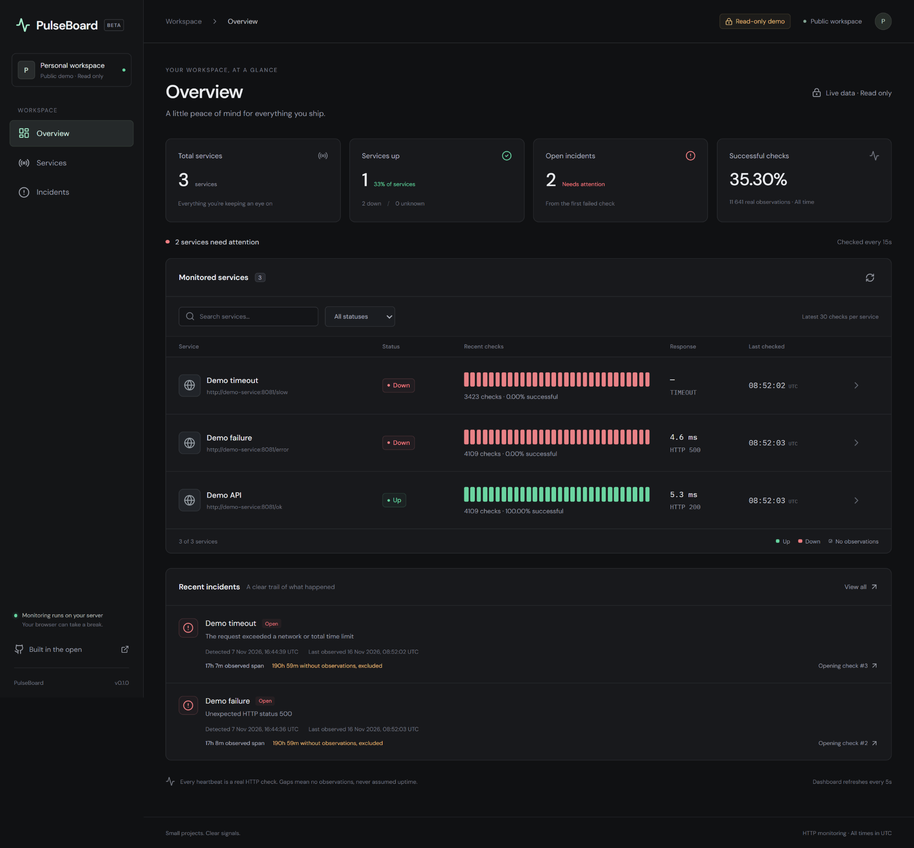
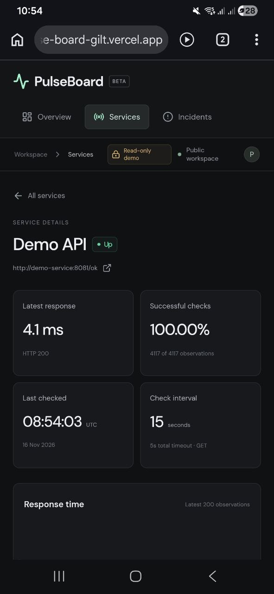
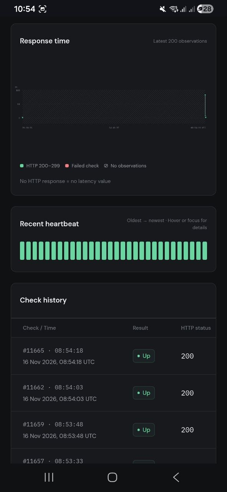
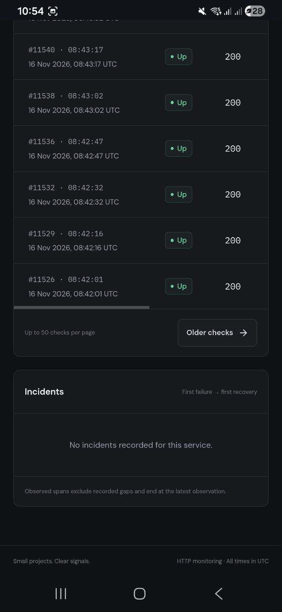

# PulseBoard screenshot gallery

All images below were captured and supplied by the project author. They show actual PulseBoard
observations. Original PNG and JPEG files are preserved without resizing, cropping, recompression,
or added cursor overlays. Open an image link to inspect its original received dimensions.

Desktop browser captures, browser mobile emulation, and actual-phone screenshots are labeled
separately. Earlier captures remain useful evidence of the original checks and local owner controls.
The latest desktop Overview and actual-phone service captures are dated 16 November 2026.

## Latest desktop Overview

Three real demo endpoints are monitored. The HTTP 500 and timeout are intentional failures.
Hatched chart areas and observation-gap labels represent periods without observations, including
VM downtime; they are not assumed uptime or fabricated checks.

## Desktop and owner workspace

| View | Capture type | Original received size | Image |
| --- | --- | --- | --- |
| Latest public Overview | Desktop browser, 2026-11-16 | 2048 × 1902 | [Open PNG](public-demo-20261116.png) |
| Healthy Demo API and response chart | Desktop browser, 2026-11-07 | 1907 × 979 | [Open PNG](service-20261107.png) |
| Public incident history | Desktop browser, 2026-11-07 | 1440 × 1100 | [Open PNG](incidents-20261107.png) |
| Original Check #2: HTTP 500 and 6.9 ms | Desktop browser, 2026-11-07 | 1885 × 990 | [Open PNG](http-500-evidence-20261107.png) |
| Original Check #3: TIMEOUT, no HTTP response or latency | Desktop browser, 2026-11-07 | 1907 × 992 | [Open PNG](timeout-evidence-20261107.png) |
| Local owner Overview with Add service and resolved incidents | Ubuntu browser, earlier capture session | 1852 × 1293 | [Open PNG](owner-overview-20261108.png) |
| Filled Add a service dialog | Ubuntu browser, earlier capture session | 1852 × 1293 | [Open PNG](add-service-20261108.png) |
| Original public Overview from MVP acceptance | Desktop browser, 2026-11-07 | 1884 × 982 | [Open PNG](public-demo-20261107.png) |

The local owner workspace supports service management. The public demo uses a separate read-only
backend and database. The filled add-service form is a capture of the form, not evidence of submission.

## Actual phone

These three screenshots were supplied from an actual phone on 16 November 2026. Each original
JPEG is **591 × 1280** and retains its phone/browser chrome where present.

| View | Image |
| --- | --- |
| Demo API title, Up state, and metric cards | [Open JPEG](mobile-service-20261116.jpg) |
| Response chart, heartbeat, and recent checks | [Open JPEG](mobile-chart-20261116.jpg) |
| Older check rows, pagination, and no service incidents | [Open JPEG](mobile-history-20261116.jpg) |

## Browser mobile emulation

These earlier captures use a **390 CSS-pixel-wide browser viewport**. They are emulation screenshots,
separate from the actual-phone captures above. Wide tables scroll within their own cards.

| View | Original received size | Image |
| --- | --- | --- |
| Full Overview | 390 × 1553 | [Open PNG](mobile-overview-20261108.png) |
| Public incident history | 390 × 862 | [Open PNG](mobile-incidents-20261108.png) |

## Verification and source

See the [verification record](../verification.md) for the executed tests and their dates.
These screenshots document captured states; they do not guarantee that the temporary public API
is always available. The [VM demo guide](../local-public-demo.md) explains how to keep it online.

[Back to the project README](../../README.md)
